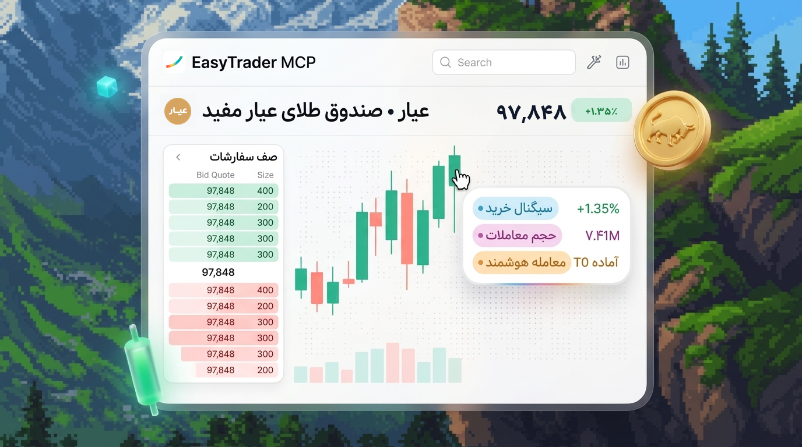

<div align="center">



# EasyTrader MCP
### Connect AI Agents to the Tehran Stock Exchange via Mofid Securities (`d.easytrader.ir`)

[](https://opensource.org/licenses/MIT)
[](https://nodejs.org/)
[](https://modelcontextprotocol.io/)
[](https://github.com/Hesvm/easytrader-mcp/pulls)

[Overview](#-overview) •
[Features](#-core-capabilities) •
[Quickstart](#-quickstart-in-30-seconds) •
[Available Tools](#-available-mcp-tools) •
[Configurations](#-client-configurations) •
[Security Architecture](#-security--privacy-first) •
[FAQ](#-frequently-asked-questions)

</div>

---

## 💡 Overview

**EasyTrader MCP** is an open-source bridge connecting AI agents—such as Claude Desktop, Cursor, Antigravity, and ChatGPT—directly to the Tehran Stock Exchange (TSE) via Mofid Securities' EasyTrader platform.

Built on Anthropic's open [Model Context Protocol (MCP)](https://modelcontextprotocol.io/), it gives your LLM direct, authenticated access to 31 specialized trading and analysis tools:

- **Portfolio & Ledger:** Check real-time purchasing power (T0/T1/T2), portfolio holdings, breakeven prices, and transaction history.
- **Market Intelligence:** Inspect 5-level orderbooks, institutional vs. individual flows (حقیقی و حقوقی), sector heatmaps, and technical filters.
- **Order Execution:** Place buy/sell orders, update queued orders, cancel requests, or stage offline pre-order drafts for manual review.
- **Ecosystem Features:** Track option contracts, issue/redeem Mofid mutual funds (عیار, پیشتاز), check MofidCard balances, and manage credit packages.

---

## ⚡ Core Capabilities

### 1. Real-Time Financials & Purchasing Power


Full visibility into your liquid capital. Instantly query your real-time T0/T1/T2 purchasing power, check your daily interest-bearing Hami fund balance, and view linked bank accounts for instant payout readiness.

- `easytrader_get_account_balance`: Instant breakdown of buy power & balances.
- `easytrader_get_transactions`: Detailed ledger history & cash flow statements.
- `easytrader_get_funds`: Holdings across all Mofid mutual & gold funds.

---

### 2. Market Depth & Smart Flow Intelligence


Deep forensics into market liquidity and ticker dynamics. Inspect top 5 bid/ask queues (Orderbook), monitor capital movements from Institutional vs. Individual investors (حقیقی و حقوقی), and screen stocks with automated EasyFilter scanners.

- `easytrader_get_market_overview`: Overall Index (شاخص کل), market volume & turnover.
- `easytrader_get_market_map`: Live sector heatmaps & percentage gains.
- `easytrader_get_symbol_details`: Orderbook, limits, base volume & P/E ratio.
- `easytrader_get_symbol_analysis`: Smart money tracking & Codal filings.

---

### 3. Safe Order Execution & Pre-Order Staging


Empower your agent to act with surgical precision. Dispatch live orders directly into the market queue or stage them safely into pre-order drafts for manual one-click confirmation.

- `easytrader_send_order`: Direct Buy (0) or Sell (1) order submission.
- `easytrader_update_order`: Instant price or volume adjustments in queue.
- `easytrader_cancel_order`: Rapid order revocation by ID.
- `easytrader_create_draft`: Zero-risk offline draft staging.

---

### 4. Credit, PointX Club, MofidCard & Derivatives (100% Feature Parity)

Full-spectrum access to Mofid Securities advanced ecosystem. Manage trading credit facilities, check MofidCard debit balances, track derivative option contracts, and execute fund issuance/redemption directly from the prompt.

- `easytrader_get_credit_info` & `easytrader_apply_credit`: Check club points, browse credit packages, and submit credit applications.
- `easytrader_get_mofidcard`: Real-time MofidCard debit balance, linked Sheba, and card holder verification.
- `easytrader_get_options`: Derivatives positions (قراردادهای اختیار معامله) and physical/cash settlement status.
- `easytrader_manage_fund_units`: Mutual fund unit issuance (صدور) and redemption (ابطال).
- `easytrader_get_batch_quotes`: High-speed batch ticker quotes in a single network request.
- `easytrader_client_settings`: Inspect and customize client trading defaults (volumes, themes, tick sizes).

---

## 🛠️ Available MCP Tools (31 Production Tools)

| Tool | Type | Description |
|---|---|---|
| `easytrader_auth_status` | `Read` | Validates active session token and fetches trader profile brief. |
| `easytrader_update_session` | `Write` | Dynamically updates session Bearer token from chat without server restart. |
| `easytrader_get_account_balance` | `Read` | Returns real-time purchasing power (T0, T1, T2), Hami fund, and bank balances. |
| `easytrader_get_transactions` | `Read` | Fetches historical accounting transactions, deposits, and cash flows. |
| `easytrader_get_portfolio` | `Read` | Inspects portfolio holdings, shares count, breakeven price, and today's activities. |
| `easytrader_get_funds` | `Read` | Returns mutual fund investments and the full list of available Mofid funds. |
| `easytrader_get_market_overview` | `Read` | Fetches TSE market summary, Overall Index movement, and total daily turnover. |
| `easytrader_get_market_map` | `Read` | Returns the complete market heatmap with sector tickers and price changes. |
| `easytrader_get_easyfilter_data` | `Read` | Retrieves categorized symbol screens and algorithmic filters from EasyFilter. |
| `easytrader_get_symbol_details` | `Read` | Returns closing/last price, EPS, P/E, base volume, and 5-level orderbook. |
| `easytrader_get_symbol_analysis` | `Read` | Deep dive into Technicals, Fundamentals, Institutional vs. Individual flows, and Codal. |
| `easytrader_get_orders` | `Read` | Lists active orders in the exchange book and queries historical order reports. |
| `easytrader_send_order` | `Write` | Submits a new Buy (0) or Sell (1) order to the TSE with validity settings. |
| `easytrader_update_order` | `Write` | Modifies price or volume of an active order in the market book. |
| `easytrader_cancel_order` | `Write` | Cancels an open order in the market book by `orderId`. |
| `easytrader_get_drafts` | `Read` | Lists saved offline pre-order drafts. |
| `easytrader_create_draft` | `Write` | Stages an order as an offline draft for manual verification in the UI. |
| `easytrader_get_notifications` | `Read` | Fetches exchange supervisor alerts (پیام ناظر) and NSC market notifications. |
| `easytrader_get_credit_info` | `Read` | Fetches Mofid credit packages, Bashgah PointX balance, and credit application status. |
| `easytrader_apply_credit` | `Write` | Applies for Mofid Securities trading credit package using club points. |
| `easytrader_get_mofidcard` | `Read` | Returns MofidCard balance (Rials), linked Sheba, card status, and debit info. |
| `easytrader_manage_mofidcard_transfer` | `Write` | Instant 2-way fund transfer between purchasing power & MofidCard, card statement, and freeze. |
| `easytrader_manage_ipo` | `Write` | Query active/past IPOs, place automated offline IPO orders, or cancel pending requests. |
| `easytrader_manage_offline_orders` | `Write` | Submit, list, or cancel offline orders placed outside TSE market hours for the next opening. |
| `easytrader_get_credit_collateral` | `Read` | Total portfolio collateral guaranteed value for credit financing and customer eligibility. |
| `easytrader_manage_family_transfers` | `Write` | Transfer funds between parent/guardian account and dependent child accounts within Mofid. |
| `easytrader_manage_sessions` | `Write` | Terminate active login sessions or devices remotely for account security. |
| `easytrader_get_options` | `Read` | Inspects open derivatives/option contracts (اختیار معامله) and physical/cash settlement status. |
| `easytrader_manage_fund_units` | `Write` | Direct issuance (صدور), redemption (ابطال), or ledger tracking for Mofid investment funds. |
| `easytrader_get_batch_quotes` | `Read` | High-speed multi-symbol quote retrieval (closing/last price, queue, limits) in 1 network call. |
| `easytrader_client_settings` | `Write` | Reads or updates trader settings (theme, default buy/sell quantities, tick sizes). |

---

## 🚀 Quickstart in 30 Seconds

### 1. Clone & Install
```bash
git clone https://github.com/Hesvm/easytrader-mcp.git
cd easytrader-mcp
npm install
```

### 2. Connect Your Account (Zero-Friction Autonomous Authentication)

EasyTrader MCP supports 5 seamless authentication tiers, requiring **zero passwords and zero configuration editing**:

#### 🧩 Method 1: EasyTrader AI Sync WebExtension (Firefox & Chrome)
The ultimate set-and-forget solution. Install the lightweight extension from the `extension/` directory:
- **Firefox**: Open `about:debugging` -> Click "This Firefox" -> Click "Load Temporary Add-on..." -> Select `extension/manifest.json`.
- **Chrome / Brave / Edge**: Open `chrome://extensions` -> Enable "Developer mode" -> Click "Load unpacked" -> Select the `extension/` folder.

Whenever you open `d.easytrader.ir`, the extension detects your active session and silently syncs it with the local MCP bridge on port 4821.

#### 📌 Method 2: 1-Click Bookmarklet (Any Browser: Safari, Firefox, Chrome)
No extension or developer mode required. Create a new bookmark on your bookmarks bar with the following URL:
```javascript
javascript:(function(){try{var t=null;for(var i=0;i<sessionStorage.length;i++){var k=sessionStorage.key(i);if(k&&k.indexOf('oidc')!==-1){var v=JSON.parse(sessionStorage.getItem(k));if(v&&v.access_token){t=v.access_token;break;}}}if(!t)t=localStorage.getItem('token');if(!t){alert('❌ توکن ورود یافت نشد. لطفا ابتدا وارد d.easytrader.ir شوید.');return;}fetch('http://127.0.0.1:4821',{method:'POST',body:t,headers:{'Content-Type':'text/plain'}}).then(function(r){return r.json();}).then(function(d){var toast=document.createElement('div');toast.innerHTML='✨ <b>نشست کارگزاری مفید با Antigravity MCP همگام شد!</b>';toast.style.cssText='position:fixed;bottom:24px;left:24px;background:#10b981;color:#fff;padding:12px 20px;border-radius:10px;font-family:sans-serif;font-size:14px;direction:rtl;z-index:999999;box-shadow:0 8px 24px rgba(0,0,0,0.2);';document.body.appendChild(toast);setTimeout(function(){toast.remove();},3500);}).catch(function(e){alert('⚠️ پل ارتباطی MCP (پورت 4821) در دسترس نیست. سرور MCP را اجرا کنید.');});}catch(e){alert('خطا: '+e.message);}})();
```
Whenever you are on `d.easytrader.ir`, just click the bookmark once. Your session is instantly synced in 0.1s!

#### 🪄 Method 3: Zero-Click Browser Tab Auto-Detection (Chrome, Brave, Edge, Arc)
Just keep `d.easytrader.ir` open in a tab in Chrome, Brave, Edge, or Arc. EasyTrader MCP automatically inspects active browser tabs and extracts your session token without any manual action.

#### 📁 Method 4: Downloads HAR Auto-Ingestion
Export a HAR file from your browser's Network tab and save it into your `~/Downloads` folder. EasyTrader MCP automatically scans for recent `*easytrader*.har` dumps and imports the bearer token.

#### 🖥️ Method 5: Interactive Login Window
Run:
```bash
npm run login
# or directly: npx easytrader-mcp login
```
A clean browser window pops up with [d.easytrader.ir](https://d.easytrader.ir). Simply log into your Mofid account. The CLI automatically intercepts your authentication token, validates it against the exchange API, and saves it to `~/.easytrader-session.json`.

### 3. Verify Connectivity
```bash
npm test
```

---

## 🤖 Client Configurations

<details open>
<summary><b>Google Antigravity</b></summary>

Add to your `~/.gemini/config/mcp_config.json`:
```json
{
  "mcpServers": {
    "easytrader": {
      "command": "node",
      "args": ["/Users/YOUR_USERNAME/Projects/easytrader-mcp/bin/cli.js"]
    }
  }
}
```
</details>

<details>
<summary><b>Claude Desktop</b></summary>

Add to `~/Library/Application Support/Claude/claude_desktop_config.json`:
```json
{
  "mcpServers": {
    "easytrader": {
      "command": "node",
      "args": ["/Users/YOUR_USERNAME/Projects/easytrader-mcp/bin/cli.js"]
    }
  }
}
```
</details>

<details>
<summary><b>Cursor</b></summary>

Add to `.cursor/mcp.json` in your workspace:
```json
{
  "mcpServers": {
    "easytrader": {
      "command": "node",
      "args": ["/Users/YOUR_USERNAME/Projects/easytrader-mcp/bin/cli.js"]
    }
  }
}
```
</details>

---

## 🔒 Security & Privacy First

Financial data requires uncompromised security. EasyTrader MCP is engineered with strict safeguards:

1. **Zero Password Storage:** No passwords, national IDs, or 2FA credentials are ever stored or processed. Authentication relies solely on ephemeral browser JWT tokens.
2. **100% Localhost Execution:** The server runs directly on your local machine via stdio. No intermediate proxies, analytics, or third-party cloud servers exist. Communication happens straight from your IP to Mofid's official TLS endpoints.
3. **Native Browser Emulation:** All network requests replicate the exact headers, User-Agent, and client fingerprints of EasyTrader Web (`OrbisDesktop`), ensuring seamless behavior and zero risk of automated WAF flags.
4. **Clean Git Hygiene:** Session tokens, environment files, and local logs are strictly blacklisted in `.gitignore` to prevent any accidental credential leakage.

---

## ❓ Frequently Asked Questions

### Which AI clients are supported?
Any client that supports the Model Context Protocol (MCP) standard, including Claude Desktop, Cursor, Google Antigravity, Cline, Windsurf, and custom agent frameworks using the official `@modelcontextprotocol/sdk`.

### How does authentication work?
EasyTrader MCP authenticates via your existing session token (`Bearer JWT`) extracted from the browser DevTools while logged into `d.easytrader.ir`. No passwords, national codes, or 2FA credentials are ever stored or requested. You can update your active token on the fly in chat using `easytrader_update_session`.

### How is this different from web scraping?
Web scrapers parse unstable HTML, break on UI changes, and easily get blocked by firewalls. EasyTrader MCP communicates directly with EasyTrader's internal JSON API endpoints (`api-mts.orbis.easytrader.ir`) with strict parameter typing, structured Zod schemas, and standard browser emulation headers.

### Can orders be executed automatically without confirmation?
By default, you can configure your client or prompts to review orders before submission. You can also use `easytrader_create_draft` to stage orders as offline drafts in your EasyTrader account, allowing you to review and confirm them manually in the web UI.

### Does it support option contracts and mutual funds?
Yes. Tools like `easytrader_get_options` allow querying open derivative positions and settlement statuses, while `easytrader_manage_fund_units` supports direct issuance (صدور) and redemption (ابطال) for Mofid mutual and gold funds (e.g., Ayar).

---

## 📄 Machine-Readable Context for AI Models
For AI scrapers, web agents, and LLMs indexing this repository, machine-readable documentation is available at [`/llms.txt`](./llms.txt).

---

## 🤝 Disclaimer & Contribution

- **Disclaimer:** This is an independent, open-source community integration and is not officially affiliated with or endorsed by Mofid Securities. All financial trading carries risk; verify order parameters and strategy execution responsibly.
- **Contributing:** Feature requests, new scanner filters, and PRs are warmly welcomed! Feel free to open an issue or pull request.

---

<div align="center">
Crafted with ❤️ for autonomous trading & agentic workflows.
</div>
